# Post-contenido Unidad 10: Memorias del Computador

**Benchmark de jerarquía de caché y análisis de memoria virtual en C sobre Linux**

| | |
|---|---|
| Estudiante | Maria Fernanda Becerra Coronel |
| Código | 1152509 |
| Curso | Arquitectura de Computadores, Universidad Francisco de Paula Santander |
| Docente | Ing. Jonathan Rey |
| Correo | mariafernandabeco@ufps.edu.co |

## Objetivo

El laboratorio mide en un equipo real cómo afecta la jerarquía de memoria al rendimiento de un programa. En la Parte 1, un benchmark en C mide la latencia de acceso para arrays de distintos tamaños con tres patrones: secuencial, aleatorio y con stride fijo. En la Parte 2 se examina la memoria virtual de procesos Linux a través de `/proc`: el mapa de regiones, la clasificación de páginas, el crecimiento de la memoria residente y el costo de un page fault individual.

## Entorno

| | |
|---|---|
| Procesador | AMD Ryzen 7 7445HS w/ Radeon 740M Graphics (6 núcleos) |
| Sistema | Ubuntu sobre WSL 2 en Windows, 7,4 GiB de RAM visibles para Linux |
| Compilador | gcc 15.2.0 (Ubuntu 15.2.0-16ubuntu1) |
| Caché L1 de datos | 32 KB por núcleo, 8 vías, 64 sets, líneas de 64 bytes |
| Caché L1 de instrucciones | 32 KB por núcleo |
| Caché L2 | 1024 KB por núcleo (6 MiB en total) |
| Caché L3 | 16 MB compartida |

Todos los tiempos son de este equipo. En otro procesador las cifras cambian, pero la forma de las curvas debería ser la misma.

## Estructura del repositorio

```
becerra-post1-u10/
├── README.md
├── parte1/
│   └── cache_bench.c        benchmark secuencial, aleatorio y con stride
├── parte2/
│   ├── mymaps.c             mapa de memoria de un proceso
│   ├── pagefault_demo.c     VmRSS antes y después de tocar 100 MB
│   └── mmap_fault_cost.c    costo de un minor page fault con mmap
└── capturas/
```

## Compilación y ejecución

Requisitos en Ubuntu: `sudo apt install build-essential time`.

```bash
# Parte 1
cd parte1
gcc -O0 -o cache_bench cache_bench.c
./cache_bench            # los tres experimentos
./cache_bench seq        # solo el secuencial
./cache_bench rand       # solo el aleatorio
./cache_bench stride     # solo el de stride

# Parte 2
cd ../parte2
gcc -o mymaps mymaps.c
sleep 300 | ./mymaps &   # queda vivo esperando Enter
PID=$!
cat /proc/$PID/maps
kill %1

gcc -o pagefault_demo pagefault_demo.c
./pagefault_demo
/usr/bin/time -v ./pagefault_demo

gcc -o mmap_fault_cost mmap_fault_cost.c
./mmap_fault_cost
./mmap_fault_cost populate
```

## Correcciones respecto a la guía

Al ejecutar el código de la guía tal cual aparecieron cinco problemas. Cada uno se corrigió y se explica aquí.

1. **`pagefault_demo.c` medía el proceso equivocado.** La guía llama a `system("grep ... /proc/self/status")`. Dentro de `grep`, `/proc/self` es el propio `grep`, no `pagefault_demo`, así que ambas lecturas mostraban unos 2 MB y el memset parecía no tener efecto. Se usa `/proc/$PPID/status`: el shell que lanza `system()` es hijo de `pagefault_demo`, de modo que `$PPID` es el PID correcto. También se agregó `VmSize`, que la guía menciona pero no imprimía, y un `fflush(stdout)` antes de cada `system()` para que los títulos salgan en orden.

2. **`mymaps` no quedaba disponible para leer su mapa.** En `gcc -o mymaps mymaps.c && ./mymaps &`, el `&` manda al fondo la cadena completa, así que `$!` es el PID de un subshell y el `cat` puede ejecutarse antes de que termine la compilación. Además, un proceso en segundo plano que llama a `getchar()` sobre la terminal recibe `SIGTTIN` y queda detenido, y el `kill` normal no lo termina mientras siga detenido. Se compila primero y se ejecuta `sleep 300 | ./mymaps &`: la entrada estándar es una tubería, el proceso espera sin detenerse, `$!` es el PID de `mymaps` y `kill %1` cierra el trabajo completo.

3. **`bench_stride` no exponía los conflictos de asociatividad.** La versión de la guía hace lecturas independientes. La CPU fuera de orden lanza varias a la vez y oculta la latencia de cada fallo de L1, así que los strides de 64 y 4096 bytes daban tiempos casi iguales. Además, la expresión `(i * stride) % n_bytes` hace una división de 64 bits en cada acceso, que pesa más que la diferencia que se quiere medir, y nunca cambia el resultado, porque `i * stride` siempre es menor que `n_bytes`. La nueva versión guarda en cada posición visitada el desplazamiento de la siguiente (persecución de punteros): cada lectura depende de la anterior y cada fallo se paga completo. Todos los strides hacen el mismo número total de accesos. Se agregaron los strides de 2048 bytes (Decisión 1) y de 4160 bytes como control: recorre las mismas 256 páginas que 4096, pero cada acceso cae en un set distinto.

4. **`bench_rand` con 100 repeticiones tardaba minutos en los arrays grandes.** Con 64 MB son 16,7 millones de accesos aleatorios por repetición, casi todos a RAM. Desde 4 MB se usan 10 repeticiones, que dan un promedio estable. El resultado se sigue dividiendo entre el número real de accesos.

5. **`mmap_fault_cost.c`**: el puntero a la página se declaró `volatile` para que el compilador no elimine el primer toque si se compila con optimización. También se agregó el argumento `populate`, que añade `MAP_POPULATE` para comprobar la Decisión 4.

---

# Parte 1: Benchmark de jerarquía de caché

## Checkpoint 1: detección de los niveles de caché

```
Cache level 0: 32K      (index0: L1 de datos)
Cache level 1: 32K      (index1: L1 de instrucciones)
Cache level 2: 1024K    (L2, privada de cada núcleo)
Cache level 3: 16384K   (L3, compartida)
```

La geometría de la L1 de datos se leyó de `/sys/devices/system/cpu/cpu0/cache/index0/`: 32 KB, 8 vías (`ways_of_associativity`), 64 sets (`number_of_sets`) y líneas de 64 bytes (`coherency_line_size`). Se cumple 8 × 64 × 64 = 32 768 bytes. `lscpu` reporta los totales de los 6 núcleos: 192 KiB de L1d (6 × 32 KB), 6 MiB de L2 (6 × 1 MB) y 16 MiB de L3 (una sola instancia).

Comparado con el «Intel Core típico» de la guía (L1 de 32 KB, L2 de 256 KB y L3 de 8 MB), la L1 coincide, la L2 es 4 veces mayor y la L3 es el doble. Por eso las etiquetas de la columna «Guia» del programa no coinciden con los niveles reales de este equipo: según este procesador, los arrays de hasta 32 KB están en L1, de 64 KB a 1 MB en L2, 4 MB en L3, y 16 y 64 MB ya superan la L3 y van a RAM.

## Checkpoint 2: latencia secuencial por tamaño de array

Salida de `./cache_bench seq`:

| Tamaño | Nivel real | ns/byte |
|---|---|---|
| 4 KB | L1 | 1,082 |
| 8 KB | L1 | 1,000 |
| 16 KB | L1 | 1,019 |
| 32 KB | L1 | 1,087 |
| 64 KB | L2 | 0,748 |
| 128 KB | L2 | 0,766 |
| 256 KB | L2 | 0,750 |
| 512 KB | L2 | 0,762 |
| 1 MB | L2 | 0,764 |
| 4 MB | L3 | 0,741 |
| 16 MB | RAM | 0,748 |
| 64 MB | RAM | 0,738 |

**El recorrido secuencial no muestra los saltos que espera la guía.** De 64 KB a 64 MB el tiempo se mantiene entre 0,738 y 0,766 ns por byte, aunque el array pasa de caber en L2 a superar la L3 cuatro veces. Hay dos razones:

1. **El bucle es más lento que la memoria.** Compilado con `-O0`, cada iteración carga `i` desde la pila, lo compara, lee `arr[i]`, incrementa `i` y lo vuelve a guardar. A unos 0,75 ns por byte, el programa consume apenas 1,3 GB/s, muy por debajo de lo que entrega incluso la RAM. La memoria nunca es el cuello de botella.
2. **El prefetcher de hardware oculta los fallos.** El patrón secuencial es el más fácil de predecir: el procesador detecta que se piden líneas consecutivas y las trae antes de que el bucle llegue a ellas. Además, de cada línea de 64 bytes solo el primer acceso podría fallar; los 63 siguientes son aciertos en L1.

Los primeros tamaños (4 a 32 KB) salieron más lentos que los siguientes, lo contrario de lo esperado. No es un efecto de la caché: son los primeros milisegundos del programa, cuando el procesador todavía está subiendo su frecuencia desde el reposo. En la ejecución completa (`p1_cp3_comparativa.png`) se repite el mismo patrón.

Los saltos entre niveles sí aparecen en el acceso aleatorio del Checkpoint 3, donde el prefetcher no puede adivinar la siguiente dirección.

## Checkpoint 3: acceso aleatorio frente a secuencial

Salidas de `./cache_bench rand` (columna «rand») y de la ejecución completa `./cache_bench` (columnas «seq» y «rand completa»):

| Tamaño | Datos tocados (arr + idx) | seq ns/byte | rand ns/acceso | rand completa | Nivel que atiende |
|---|---|---|---|---|---|
| 4 KB | 12 KB | 0,987 | 2,098 | 1,398 | L1 (arranque) |
| 8 KB | 24 KB | 1,070 | 2,114 | 1,534 | L1 |
| 16 KB | 48 KB | 1,119 | 1,556 | 1,557 | L1/L2 |
| 32 KB | 96 KB | 1,019 | 1,574 | 1,038 | L2 |
| 64 KB | 192 KB | 0,764 | 1,640 | 1,052 | L2 |
| 128 KB | 384 KB | 0,750 | 1,170 | 1,068 | L2 |
| 256 KB | 768 KB | 0,746 | 1,159 | 1,075 | L2 |
| 512 KB | 1,5 MB | 0,768 | 1,304 | 1,207 | L2/L3 |
| 1 MB | 3 MB | 0,760 | 1,674 | 1,560 | L3 |
| 4 MB | 12 MB | 0,756 | 2,163 | 1,997 | L3, fallos de TLB |
| 16 MB | 48 MB | 0,742 | 19,063 | 11,720 | RAM |
| 64 MB | 192 MB | 0,740 | 15,468 | 14,784 | RAM, fallos de TLB |

Para leer la tabla hay que tener en cuenta que `bench_rand` no toca solo el array: el vector `idx` usa 8 bytes por cada `int` de 4 bytes, así que los datos tocados son el triple del tamaño nominal. Con esa corrección aparecen tres saltos claros, y en las dos ejecuciones se repiten casi iguales:

1. **De 512 KB a 1 MB** (de 1,2–1,3 a 1,6–1,7 ns): los 3 MB de datos ya no caben en la L2 de 1 MB y los accesos se resuelven en L3.
2. **De 1 MB a 4 MB** (de 1,6–1,7 a 2,0–2,2 ns): con 12 MB de datos, la L3 de 16 MB está casi llena y los fallos de L3 empiezan a aparecer. Además, 4 MB de `arr` son 1024 páginas, muchas más de las que cubre el TLB de primer nivel, así que una parte de los accesos paga también un fallo de TLB.
3. **De 4 MB a 16 MB** (de unos 2 ns a entre 11,7 y 19,1 ns, de 6 a 9 veces más): los 48 MB de datos superan la L3 y casi cada acceso va a RAM. El 19,1 de la ejecución aislada es una medición con ruido: en la ejecución completa el mismo tamaño dio 11,7 y quedó por debajo del de 64 MB, como se espera. Lo que se repite en ambas es el orden de magnitud. A 64 MB se mantiene entre 14,8 y 15,5 ns porque, además, las 16 384 páginas de `arr` superan el TLB de segundo nivel y cada fallo obliga a recorrer la tabla de páginas.

Por debajo de 512 KB, el aleatorio cuesta poco más que el secuencial y no se distingue L1 de L2. Las lecturas de `arr[idx[i]]` son independientes entre sí, y el procesador ejecuta varias a la vez, así que la latencia de L2 (unos 14 ciclos) queda oculta. Por la misma razón, los 11,7 a 15,5 ns medidos en RAM son menores que la latencia real de un acceso a DRAM (del orden de 80 a 100 ns): miden cuántos accesos se completan por unidad de tiempo con varios en vuelo, no cuánto tarda uno aislado. Aun así, la diferencia con el secuencial es enorme: a 64 MB el aleatorio cuesta 20 veces más por acceso (14,8 frente a 0,74 ns).

## Checkpoint 4: conflictos de asociatividad con stride

Cuatro ejecuciones de `./cache_bench stride` sobre el mismo array de 1 MB (capturas `p1_cp3_comparativa.png`, `p1_cp4_ejecucion.png` y `p1_cp4_repeticion.png`):

| Stride | Accesos por vuelta | Ejecución 1 | Ejecución 2 | Ejecución 3 | Ejecución 4 |
|---|---|---|---|---|---|
| 64 B | 16 384 | 2,836 | 2,655 | 2,881 | 2,876 |
| 2048 B | 512 | 3,913 | 4,412 | 3,976 | 3,950 |
| 4096 B | 256 | 4,043 | 4,281 | 4,473 | 4,288 |
| 4160 B (control) | 252 | 3,112 | 2,913 | 2,917 | 2,929 |

(ns por acceso)

El stride de 4096 bytes es entre un 43 % y un 61 % más lento que el de 64 bytes en todas las ejecuciones, aunque los dos recorren el mismo array de 1 MB. La diferencia no se debe a un tamaño de trabajo distinto: con 4096 bytes solo se tocan 256 líneas, es decir, 256 × 64 B = 16 KB, la mitad de la L1. El problema es dónde caen. Con 64 sets y líneas de 64 bytes, las direcciones separadas por 4096 bytes comparten los bits 6 a 11, que eligen el set, así que las 256 líneas compiten por las 8 vías de un único set. Cada acceso desaloja una línea que se volverá a necesitar y ninguno acierta en L1: son **conflict misses**. Esas líneas sí caben en la L2 de 1 MB, que tiene 2048 sets, así que cada acceso se resuelve ahí, con unos 1,2 a 1,6 ns extra.

El stride de control lo confirma. Con 4160 bytes (4096 + 64), los accesos visitan casi las mismas 256 páginas, así que la presión sobre el TLB es la misma, pero cada uno avanza un set: las 252 líneas se reparten entre los 64 sets, unas 4 por set, y caben en las 8 vías. Su tiempo (2,9 a 3,1 ns) queda mucho más cerca del de 64 bytes que del de 4096.

El stride de 64 bytes recorre las líneas una tras otra: cada acceso es a una línea nueva, pero el prefetcher la trae antes y casi todos aciertan en L1. Lo que se mide ahí es, sobre todo, la latencia de L1 encadenada más el costo del bucle a `-O0`.

## Checkpoint 5: decisiones técnicas de la Parte 1

### Decisión 1: ¿qué stride expone mejor los conflictos de asociatividad en esta caché?

En una L1 de 32 KB con 8 vías y líneas de 64 bytes hay 32 768 / (8 × 64) = 64 sets. Los 6 bits más bajos de la dirección (0 a 5) eligen el byte dentro de la línea, y los 6 siguientes (6 a 11) eligen el set. Dos direcciones caen en el mismo set cuando coinciden en los bits 6 a 11, es decir, cuando están separadas por un múltiplo de 64 × 64 = 4096 bytes. Por eso el stride que garantiza que todos los accesos compitan por el mismo set es el tamaño de la caché dividido entre sus vías: 32 KB / 8 = 4096 bytes. Cualquier múltiplo (8192, 16 384) también cae en un solo set, pero 4096 es el menor y, sobre el mismo array, produce el mayor número de accesos en conflicto. La misma cuenta vale para las L1 de 48 KB con 12 vías de muchos procesadores Intel recientes: también tienen 64 sets.

Con un stride de 2048 bytes, el bit 11 alterna entre 0 y 1 y los bits 6 a 10 quedan fijos, así que los accesos recorren dos sets de forma alternada. Cada set recibe la mitad de las líneas y los conflictos por set se reducen a la mitad. Sin embargo, en un array de 1 MB eso no basta: siguen siendo 256 líneas por set frente a 8 vías, así que casi todos los accesos fallan igual. Para que los conflictos desaparecieran, el array tendría que ser de 2 × 8 × 2048 = 32 KB o menos. En la medición, 2048 queda entre 64 y 4096, en parte porque cada página se visita dos veces y hay menos fallos de TLB.

Con 4096 bytes, el array de 1 MB aporta 256 líneas distintas a un set de 8 vías. Desde el noveno acceso, cada línea nueva desaloja a otra, y como el recorrido es cíclico y el reemplazo aproxima LRU, la línea desalojada es justo la que se necesitará antes. Ningún acceso acierta en L1 y todos se resuelven en L2, con una latencia unas tres veces mayor. En el recorrido secuencial del Checkpoint 2, en cambio, solo falla el primer byte de cada línea de 64, y el prefetcher suele traerla antes. El stride de control de 4160 bytes confirma la causa: visita las mismas 256 páginas, pero cada acceso cae en un set distinto, y su tiempo vuelve al nivel del de 64 bytes. Además, los datos tocados con 4096 son 256 × 64 B = 16 KB, la mitad de la L1, así que no son fallos de capacidad sino de conflicto.

### Decisión 2: ¿`-fno-prefetch-loop-arrays` deshabilita el mismo prefetching que el prefetcher de hardware?

No. El flag solo controla las instrucciones `prefetcht0` y `prefetchw` que gcc decide insertar en el código generado. El prefetcher de hardware vive en el procesador, observa las direcciones que pide cualquier programa y se activa sin importar cómo se compiló. Solo se desactiva desde registros MSR (por ejemplo el 0x1A4 en procesadores Intel) o desde la BIOS, y eso depende del modelo de CPU.

Además, el flag solo tiene efecto con optimización. Se comprobó contando las instrucciones de prefetch en el ensamblador generado:

```bash
gcc -O0 -fprefetch-loop-arrays    -S -o - cache_bench.c | grep -c prefetch   # 0
gcc -O2 -fprefetch-loop-arrays    -S -o - cache_bench.c | grep -c prefetch   # 5
gcc -O2 -fno-prefetch-loop-arrays -S -o - cache_bench.c | grep -c prefetch   # 0
```

Con `-O0`, como se compila en este laboratorio, gcc no inserta ninguno de los dos modos. Con `-O2` aparecen 5 instrucciones, todas en `bench_rand`, en los bucles que recorren `arr` e `idx` de forma secuencial.

En principio, el patrón más sensible es el secuencial, porque sus direcciones futuras son las más fáciles de predecir. En este código, sin embargo, gcc no inserta prefetch en `bench_seq`, porque sus lecturas son `volatile` y el compilador no puede tocarlas. Aunque lo hiciera, la ganancia sería pequeña, porque el prefetcher de hardware ya cubre ese recorrido. El patrón aleatorio es insensible: la dirección `arr[idx[i]]` depende de la mezcla de Fisher-Yates y el compilador solo puede adelantar la lectura de `idx`. El stride de 4096 también lo es: en la versión con lecturas dependientes, la siguiente dirección se conoce solo cuando llega la lectura anterior, y aunque se adelantaran líneas, todas irían al mismo set y se desalojarían entre sí.

La conclusión válida es limitada: comparar los dos flags mide solo el aporte del prefetch por software de gcc, con el prefetcher de hardware activo en ambos casos. Una diferencia pequeña o nula no prueba que el prefetching no sirva; prueba que el hardware ya hacía ese trabajo.

---

# Parte 2: Análisis de memoria virtual en Linux

## Checkpoint 1: regiones del mapa de memoria

`mymaps` (PID 2999) imprimió:

```
stack var addr: 0x7fff294a0b80
heap addr:      0x7dda120ff010
global addr:    0x62019df35010
rodata addr:    0x62019df33008
code addr:      0x62019df32209
```

Regiones de `/proc/2999/maps`, agrupadas:

| Rango | Permisos | Mapeo | Qué contiene |
|---|---|---|---|
| `62019df31000-62019df32000` | `r--p` | mymaps | Cabecera ELF y tablas del enlazador |
| `62019df32000-62019df33000` | `r-xp` | mymaps | **Texto (.text)**: el código de `main` (`code addr` 0x…32209) |
| `62019df33000-62019df34000` | `r--p` | mymaps | **Solo lectura (.rodata)**: la cadena `"hola"` (`rodata addr` 0x…33008) |
| `62019df34000-62019df35000` | `r--p` | mymaps | RELRO: la tabla de símbolos resueltos, que el cargador vuelve de solo lectura después de enlazar |
| `62019df35000-62019df36000` | `rw-p` | mymaps | **Datos (.data/.bss)**: `global_data` y el puntero `msg` (`global addr` 0x…35010) |
| `6201a9c55000-6201a9c76000` | `rw-p` | `[heap]` | **Heap** de 132 KB crecido con `brk`, que glibc usa para bloques pequeños, como el buffer de `printf` |
| `7dda120ff000-7dda12200000` | `rw-p` | anónimo | **El bloque de 1 MB de `malloc`** (`heap addr` 0x7dda120ff010) |
| `7dda12200000-7dda12414000` | `r--p`, `r-xp`, `r--p`, `r--p`, `rw-p` | libc.so.6 | **libc**: cabecera, código, constantes, RELRO y datos |
| `7dda12414000-7dda124c5000` | `rw-p` | anónimo | Datos sin nombre de libc y del cargador (TLS, `.bss` de libc) |
| `7dda124c5000-7dda124cd000` | `r--p`, `r-xp` | `[vvar]`, `[vvar_vclock]`, `[vdso]` | **vDSO**: código del kernel mapeado en el proceso para que `clock_gettime` funcione sin llamada al sistema, y las variables que lee |
| `7dda124cd000-7dda1250b000` | `r--p`, `r-xp`, `r--p`, `r--p`, `rw-p` | ld-linux-x86-64.so.2 | **Cargador dinámico**, que enlazó libc al iniciar |
| `7fff29481000-7fff294a2000` | `rw-p` | `[stack]` | **Pila** de 132 KB (`stack var addr` 0x7fff294a0b80, cerca del extremo superior porque la pila crece hacia abajo) |

En los permisos, `r`, `w` y `x` son lectura, escritura y ejecución, y `p` indica un mapeo privado con copy-on-write: si el proceso escribe en una página compartida, recibe su propia copia. Ninguna región es `w` y `x` a la vez: el código no se puede modificar y los datos no se pueden ejecutar (W^X), lo que bloquea la inyección directa de código.

Dos detalles muestran cómo funciona realmente la memoria. Primero, el bloque de 1 MB no está en `[heap]`: para bloques de 128 KB o más, glibc usa `mmap` anónimo, y por eso aparece como una región sin nombre de 1028 KB (1 MB más la cabecera de `malloc`, redondeado a páginas) junto a las bibliotecas. Segundo, las direcciones cambian en cada ejecución: en la primera prueba, con PID 2357, el código estaba en 0x5abf95f15209 y la pila en 0x7fffee6423e0. Es ASLR, que coloca el ejecutable (compilado como PIE), las bibliotecas, el heap y la pila en posiciones aleatorias.

## Checkpoint 2: clasificación de páginas en smaps

Campos de `/proc/2999/smaps` para tres regiones:

| Región | Size | Rss | Shared_Clean | Private_Dirty | Referenced |
|---|---|---|---|---|---|
| `[heap]` | 132 kB | 8 kB | 0 kB | 8 kB | 8 kB |
| libc.so.6 `r-xp` (código) | 1632 kB | 1248 kB | 1248 kB | 0 kB | 1248 kB |
| `[stack]` | 132 kB | 12 kB | 0 kB | 12 kB | 12 kB |

**Private_Dirty: heap y pila.** Son memoria anónima: no vienen de ningún archivo y solo existen porque el proceso escribió en ellas. Cada página se creó en un page fault al escribir por primera vez, así que está modificada (*dirty*) y pertenece a un solo proceso (*private*). Si el sistema necesitara liberarla, no podría descartarla, porque no hay una copia en disco: tendría que enviarla a swap. Además, de los 132 kB reservados de cada una solo 8 y 12 kB están en RAM: el resto nunca se tocó.

**Shared_Clean: el código de libc.** Esas páginas se leen del archivo `libc.so.6` y nunca se modifican, porque la región es `r-xp`. El kernel mantiene una sola copia en la caché de páginas y la mapea en todos los procesos que usan libc (aquí, al menos `bash` y `mymaps`), por eso son *shared*. Son *clean* porque coinciden con el archivo: si falta memoria, el kernel puede descartarlas y volver a leerlas del disco sin escribir nada. De los 1632 kB de código, 1248 kB están en RAM, los que algún proceso ya ejecutó.

`pmap -x 2999` resume lo mismo por región: 3796 kB de espacio virtual, de los que solo 1952 kB están en RAM y 104 kB modificados. El bloque de 1 MB de `malloc` aparece como `[ anon ]` de 1028 kB con solo 4 kB residentes, porque `mymaps` nunca escribe en él: es demand paging, el mismo efecto que mide el Checkpoint 3. `pmap -x` muestra el RSS y la columna `Dirty`, pero no distingue compartido de privado; por eso la clasificación se hizo con `smaps` (ver la Decisión 3).

En todo el sistema, `free -h` reporta 7,4 GiB, con 566 MiB usados, 6,8 GiB disponibles y el swap de 2 GiB sin usar; `vmstat -s` da las mismas cifras en kB (7 736 080 total, 575 480 usados, 0 de swap usado).

## Checkpoint 3: VmRSS y conteo de page faults

| | VmSize | VmRSS |
|---|---|---|
| Antes del memset | 105 172 kB | 1 880 kB |
| Después del memset | 105 172 kB | 104 280 kB |
| Diferencia | 0 | +102 400 kB = 100 MB exactos |

`malloc(100 MB)` reserva el espacio virtual de inmediato: VmSize ya incluye los 100 MB antes del memset y no cambia después. Pero VmRSS, las páginas que de verdad están en RAM, solo suma 1,8 MB, los del propio programa y de libc. Para un bloque de ese tamaño, glibc usa `mmap` anónimo, y el kernel solo crea la región en la tabla de áreas del proceso, sin asignar ningún marco físico. Es la **asignación diferida (demand paging)**: la primera escritura en cada página provoca un page fault, y solo entonces el kernel toma un marco libre, lo llena de ceros y lo enlaza en la tabla de páginas. El memset toca las 25 600 páginas de 4 KB, y VmRSS crece exactamente 102 400 kB.

`/usr/bin/time -v` reporta:

| Campo | Valor |
|---|---|
| Minor (reclaiming a frame) page faults | 26 047 |
| Major (requiring I/O) page faults | 0 |
| Maximum resident set size | 104 056 kB |

Los 26 047 minor faults son las 25 600 páginas del memset más unos 447 del arranque: cargar el ejecutable y las bibliotecas, preparar la pila, y los procesos `sh` y `grep` que lanza `system()`, que `time` también cuenta. Todos son **minor**, porque ninguno necesita leer del disco: las páginas anónimas se crean llenas de ceros, y las de libc ya estaban en la caché de páginas del sistema. Un **major** fault ocurriría si la página tuviera que leerse del disco, por ejemplo un archivo mapeado que no está en caché o una página que fue enviada a swap. Con 6,8 GiB libres y el swap sin usar (`p2_cp2_vmstat.png`), no hubo ninguno.

## Checkpoint 4: costo medido de un minor page fault

| Ejecución | Primer toque | Segundo toque | Overhead del fault |
|---|---|---|---|
| `./mmap_fault_cost` (1) | 1879,0 ns | 27,2 ns | 1851,8 ns |
| `./mmap_fault_cost` (2) | 2334,2 ns | 35,0 ns | 2299,2 ns |
| `./mmap_fault_cost populate` | 24,1 ns | 23,1 ns | 1,0 ns |

El primer toque de cada página cuesta entre 1,9 y 2,3 µs, y el segundo, unos 30 ns. El segundo tiempo es casi todo el costo de las dos llamadas a `clock_gettime`; la escritura en sí, con la traducción ya en el TLB, tarda unos pocos ciclos. El overhead del minor page fault es, por tanto, de unos **1,9 a 2,3 µs**: la excepción, la entrada al kernel, la búsqueda del área virtual, la asignación de un marco, la puesta a cero de 4 KB, la actualización de la tabla de páginas y el retorno. La variación entre ejecuciones viene sobre todo de cómo esté el asignador de marcos del kernel en ese momento.

Comparado con la Parte 1, un fault cuesta lo mismo que unos 125 a 155 accesos aleatorios a RAM del benchmark (14,8 ns cada uno), y entre 20 y 30 veces la latencia real de un acceso a DRAM (80 a 100 ns): son **dos órdenes de magnitud más** que un acceso a memoria. Por eso un programa que toca memoria nueva por primera vez paga mucho más que uno que reutiliza la que ya tiene. Con `MAP_POPULATE`, el primer y el segundo toque cuestan lo mismo, porque los faults ya se pagaron dentro de `mmap` (ver la Decisión 4).

## Checkpoint 5: decisiones técnicas de la Parte 2

### Decisión 3: ¿`/proc/PID/smaps` o `pmap -x` para este análisis?

Si solo se necesita el RSS de cada región, `pmap -x` lo reporta: muestra la dirección, el tamaño reservado (`Kbytes`), las páginas en RAM (`RSS`), las páginas modificadas (`Dirty`), los permisos y el nombre del mapeo. Lo que no muestra es la separación entre páginas compartidas y privadas, ni entre limpias y sucias, dentro de una misma región: `smaps` da por separado `Shared_Clean`, `Shared_Dirty`, `Private_Clean` y `Private_Dirty`, además de `Referenced`, `Anonymous`, `Swap` y `Pss`. Para el Checkpoint 2, que pide distinguir una región `Private_Dirty` de una `Shared_Clean`, solo sirve `smaps`.

Leer `smaps` es costoso porque, para calcular cada cifra, el kernel recorre las tablas de páginas de todas las regiones mientras retiene el bloqueo de lectura del mapa de memoria del proceso. En un proceso con cientos de regiones y gigabytes mapeados, eso tarda milisegundos y puede retrasar los page faults y los `mmap` del proceso observado. Un script que consulta cada segundo lo notaría. Hay un detalle que la guía no menciona: `pmap -x` obtiene el RSS leyendo el mismo `smaps`. Se comprobó con `strace -e trace=openat pmap -x <PID>`, que muestra que abre `/proc/<PID>/smaps`. Por eso `pmap -x` no es más liviano para el kernel; solo ahorra el trabajo de formatear. Para un monitoreo frecuente que solo necesita totales convienen `/proc/PID/statm`, la línea `VmRSS` de `/proc/PID/status` o `/proc/PID/smaps_rollup`, que entrega los totales sin una línea por región.

La conclusión es usar `pmap -x` en una inspección rápida por terminal, porque presenta en una tabla ya resumida lo que con `smaps` habría que filtrar con `grep` o `awk`. Conviene leer `smaps` directamente cuando el análisis necesita el tipo de página de cada región, como en este laboratorio, o campos que `pmap -x` no muestra, como `Referenced` o `Swap`.

### Decisión 4: ¿`mmap` con `MAP_POPULATE` o demand paging por defecto?

Con `MAP_POPULATE`, el kernel asigna marcos y llena las tablas de páginas de todo el rango dentro de la propia llamada a `mmap`. Al llegar al bucle, las 200 páginas ya están presentes, así que el primer toque cuesta casi lo mismo que el segundo, unas decenas de nanosegundos, en lugar de los microsegundos del Checkpoint 4. El costo no desaparece: se traslada a la llamada a `mmap`. El programa lo permite comprobar con `./mmap_fault_cost populate`, donde el overhead atribuible al fault cae prácticamente a cero.

`MAP_POPULATE` conviene cuando la latencia de cada operación importa más que el tiempo de arranque. Un servidor que atiende peticiones con un tiempo de respuesta acotado, o un sistema en tiempo real, prefiere pagar todos los faults al iniciar para que ninguna petición sufra varios microsegundos extra por tocar una página nueva. Lo mismo vale para un programa que reserva un buffer y luego lo recorre completo, como un procesador por lotes, aunque ahí la diferencia solo cambia cuándo se paga. El demand paging conviene a los programas que reservan de forma especulativa o generosa: pilas de hilos, arenas de `malloc`, cachés que pueden no llenarse.

Si un proceso reserva 100 MB y solo toca 10 MB, el demand paging asigna únicamente las 2560 páginas usadas. Con `MAP_POPULATE`, el kernel habría asignado y puesto a cero las 25 600 páginas: 90 MB de RAM ocupados sin uso, que podrían forzar a otros procesos a enviar páginas a swap, y unas 23 000 asignaciones extra, que a 1–5 µs cada una son decenas de milisegundos de arranque perdidos.

---

# Capturas

Las capturas de terminal se tomaron en Ubuntu sobre WSL 2; las de las decisiones, sobre este README.

## Parte 1

| Checkpoint | Capturas |
|---|---|
| CP1 Caché detectada | [p1_cp1_cache.png](capturas/p1_cp1_cache.png), [p1_cp1_geometria.png](capturas/p1_cp1_geometria.png) |
| CP2 Latencia secuencial | [p1_cp2_compilacion.png](capturas/p1_cp2_compilacion.png), [p1_cp2_ejecucion.png](capturas/p1_cp2_ejecucion.png) |
| CP3 Aleatorio frente a secuencial | [p1_cp3_ejecucion.png](capturas/p1_cp3_ejecucion.png), [p1_cp3_comparativa.png](capturas/p1_cp3_comparativa.png) |
| CP4 Stride y asociatividad | [p1_cp4_ejecucion.png](capturas/p1_cp4_ejecucion.png), [p1_cp4_repeticion.png](capturas/p1_cp4_repeticion.png) |
| CP5 Decisiones 1 y 2 | [p1_cp5_decision1.png](capturas/p1_cp5_decision1.png), [p1_cp5_decision2.png](capturas/p1_cp5_decision2.png), [p1_cp5_prefetch.png](capturas/p1_cp5_prefetch.png) |

**CP1 Caché detectada**

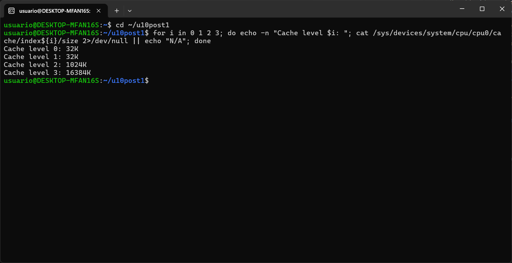

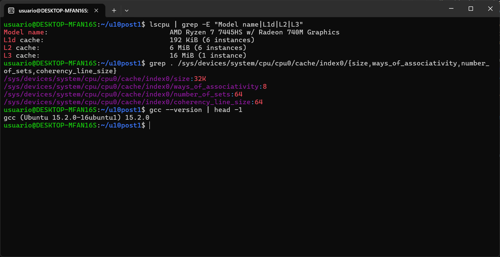

**CP2 Latencia secuencial**

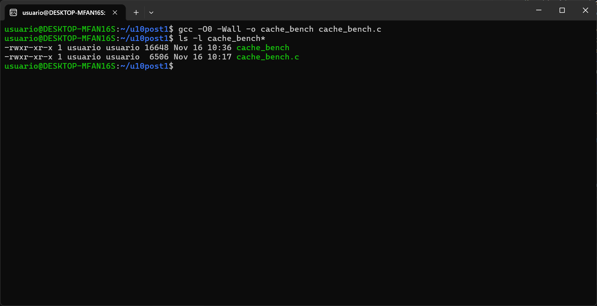

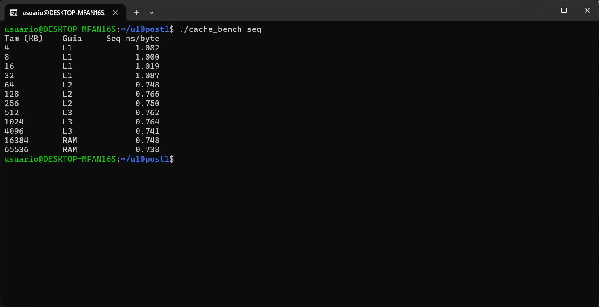

**CP3 Aleatorio frente a secuencial**

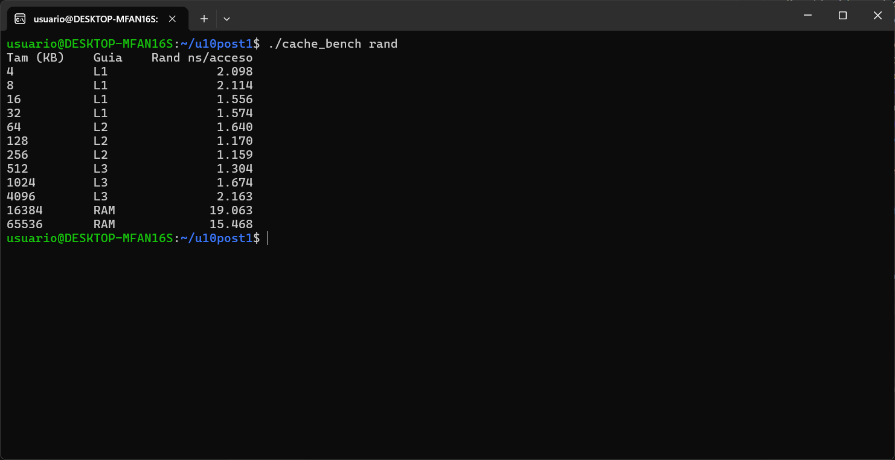

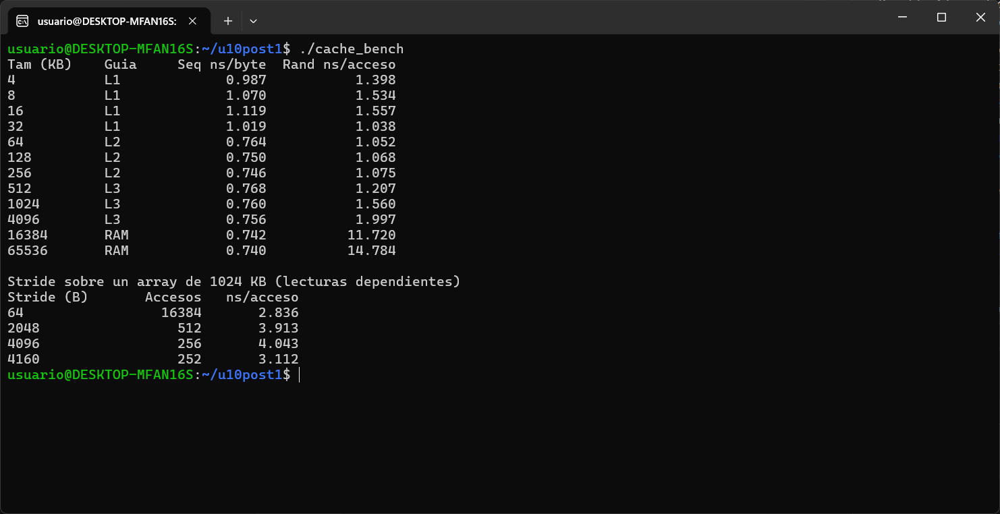

**CP4 Stride y asociatividad**

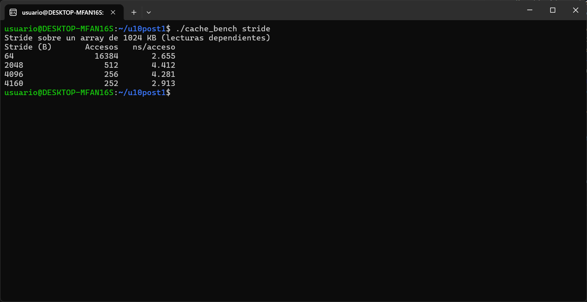

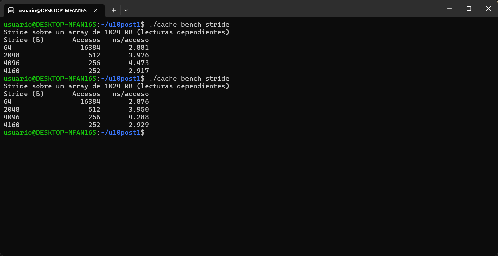

**CP5 Decisiones 1 y 2**

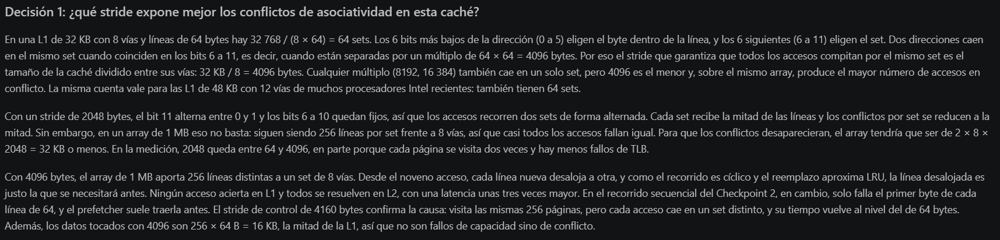

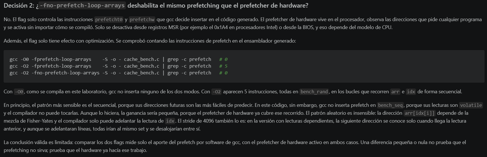

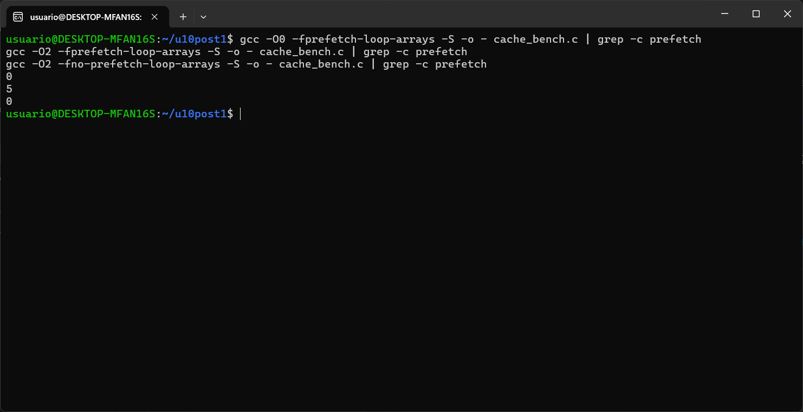


## Parte 2

| Checkpoint | Capturas |
|---|---|
| CP1 Mapa de memoria | [p2_cp1_ejecucion.png](capturas/p2_cp1_ejecucion.png), [p2_cp1_maps.png](capturas/p2_cp1_maps.png) |
| CP2 smaps y pmap | [p2_cp2_smaps.png](capturas/p2_cp2_smaps.png), [p2_cp2_pmap.png](capturas/p2_cp2_pmap.png), [p2_cp2_vmstat.png](capturas/p2_cp2_vmstat.png) |
| CP3 VmRSS y page faults | [p2_cp3_ejecucion.png](capturas/p2_cp3_ejecucion.png), [p2_cp3_time.png](capturas/p2_cp3_time.png) |
| CP4 Costo de un page fault | [p2_cp4_compilacion.png](capturas/p2_cp4_compilacion.png), [p2_cp4_ejecucion.png](capturas/p2_cp4_ejecucion.png) |
| CP5 Decisiones 3 y 4 | [p2_cp5_decision3.png](capturas/p2_cp5_decision3.png), [p2_cp5_decision4.png](capturas/p2_cp5_decision4.png) |

**CP1 Mapa de memoria**

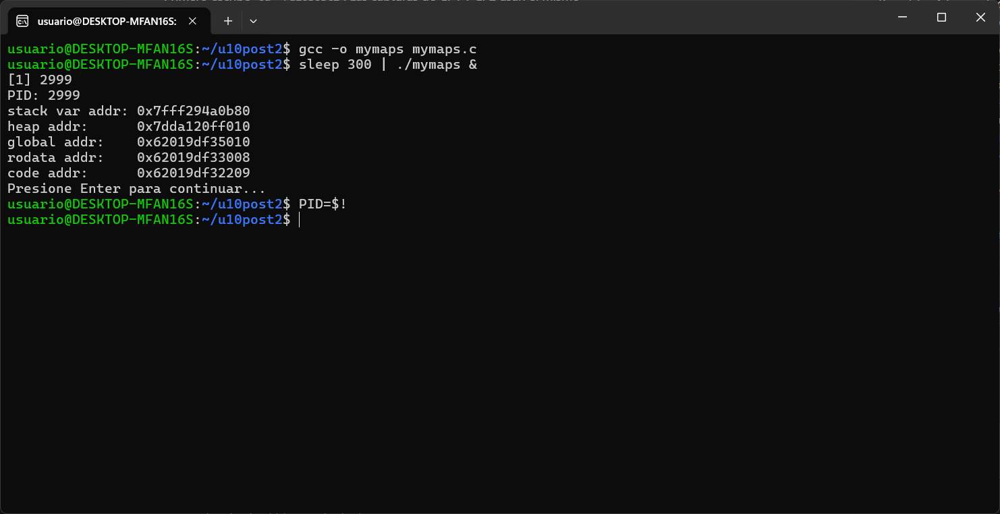

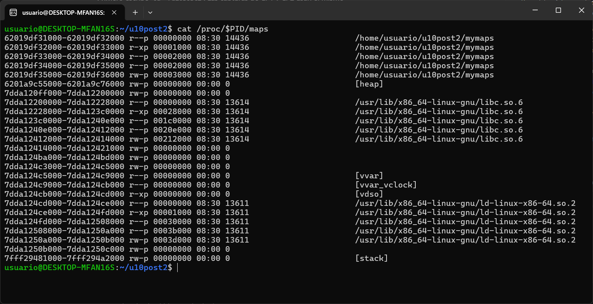

**CP2 smaps y pmap**

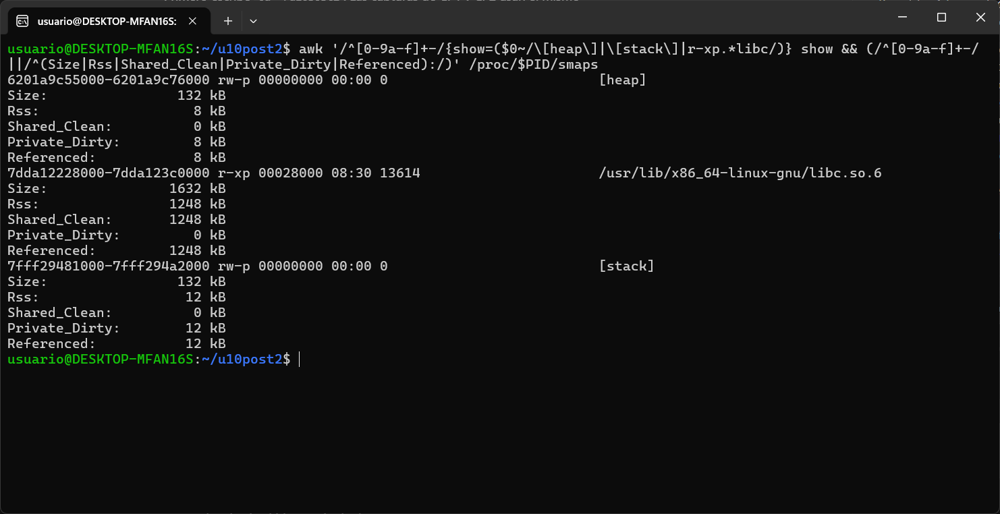

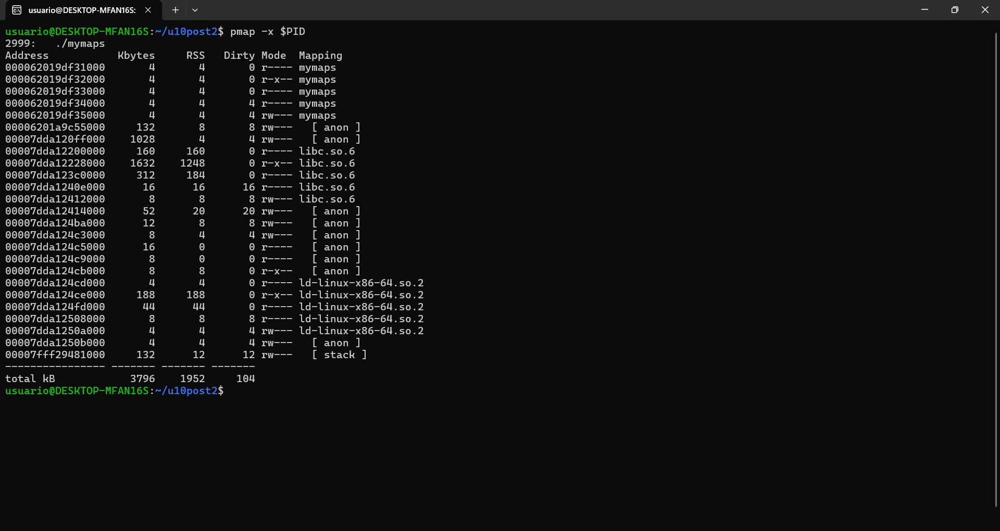

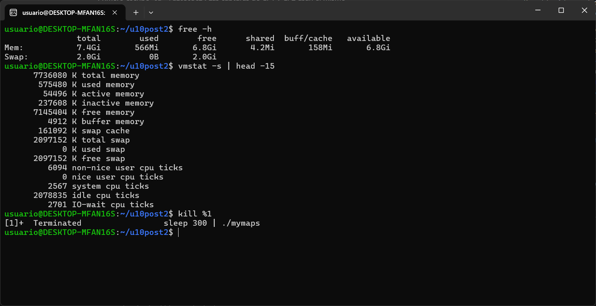

**CP3 VmRSS y page faults**

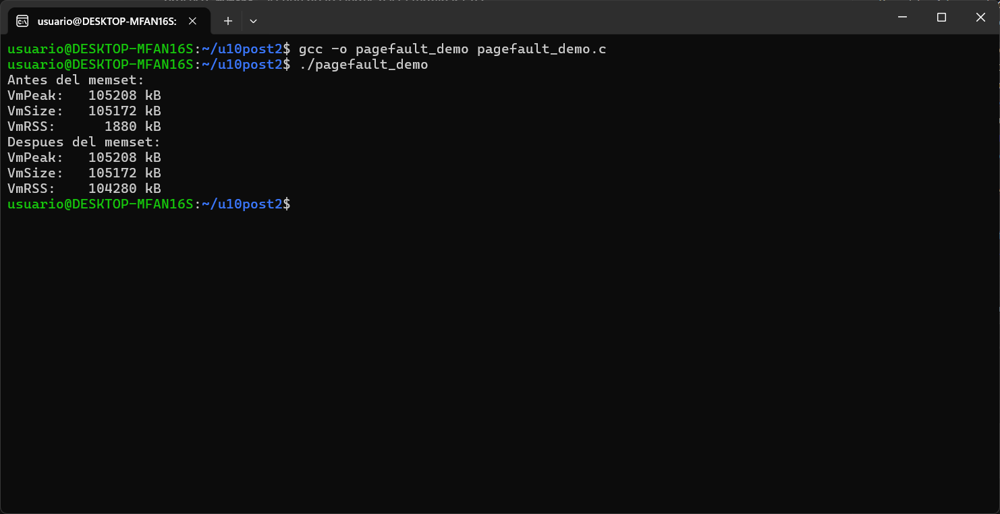

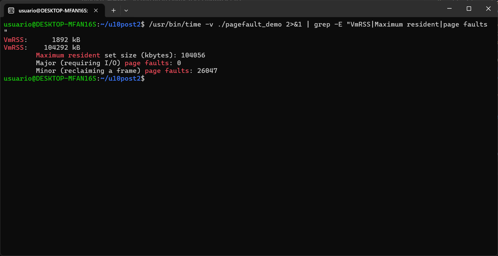

**CP4 Costo de un page fault**

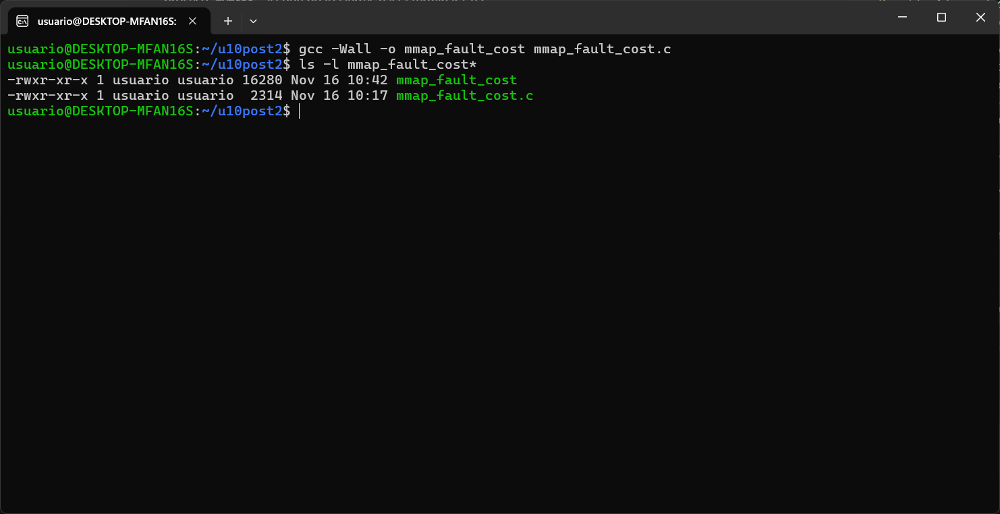

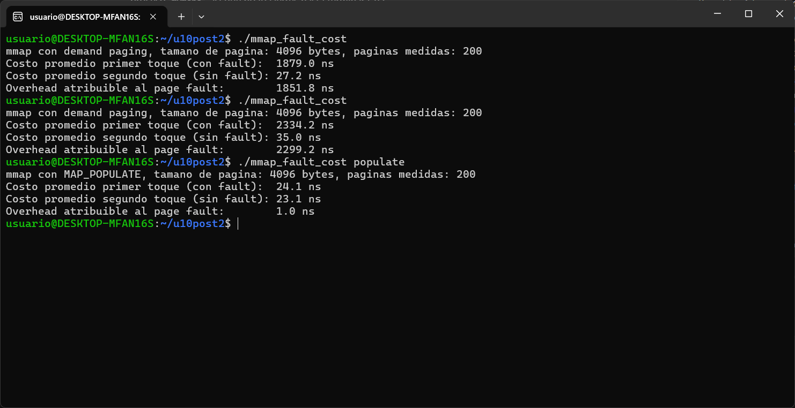

**CP5 Decisiones 3 y 4**

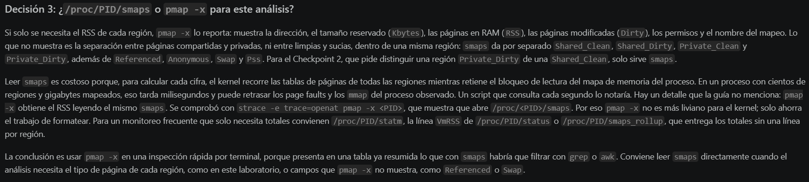

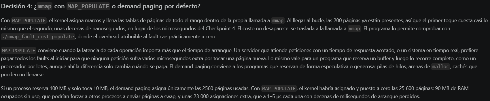


# Conclusiones

La jerarquía de memoria se ve en las mediciones, pero solo con un benchmark que la deje ver. El recorrido secuencial de la guía da el mismo 0,75 ns por byte desde 64 KB hasta 64 MB, porque el prefetcher de hardware y el costo del bucle a `-O0` ocultan los niveles. El acceso aleatorio, en cambio, muestra los tres saltos: L2 a L3 cerca de 1 MB, el límite de la L3 cerca de 4 MB y la RAM a partir de 16 MB, donde cada acceso cuesta unas 20 veces más que en el secuencial. El stride de 4096 bytes demostró que una caché puede fallar aun con poca carga de datos: 16 KB repartidos en un solo set de una L1 de 32 KB fueron entre un 43 % y un 61 % más lentos que un recorrido normal, y el stride de control de 4160 bytes confirmó que la causa era la asociatividad y no el TLB.

En la Parte 2, `/proc` mostró que la memoria virtual que reserva un proceso y la memoria física que usa son cosas distintas. `malloc` de 100 MB no ocupó RAM hasta que el memset tocó las 25 600 páginas, y cada una costó un minor page fault de unos 2 µs, dos órdenes de magnitud más que un acceso a RAM. `smaps` permitió ver por qué el código de libc se comparte entre procesos y el heap y la pila no. Las correcciones a la guía fueron necesarias para medir lo que se quería medir: leer `/proc/self` desde `system()` mide a `grep`, y unas lecturas independientes con una división en cada acceso ocultan exactamente el efecto que se buscaba.
